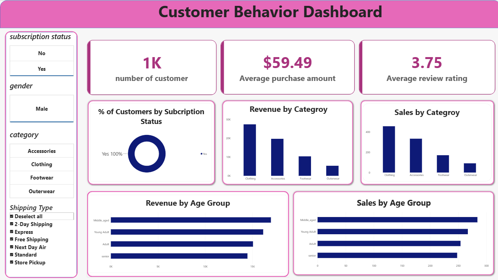

# Customer Behavior Dashboard

An interactive Power BI dashboard that analyzes customer purchase behavior across product categories, age groups, subscription status, gender and shipping type.



## Objective
Understand who buys what, how much revenue each category and age group generates, and how subscription status affects customer behavior.

## Key Metrics (as shown in the current filtered view)
| Metric | Value |
|---|---|
| Number of customers | 1K |
| Average purchase amount | $59.49 |
| Average review rating | 3.75 |

> Current view is filtered to **Subscription = Yes** and **Gender = Male**.

## Dashboard Features
- KPI cards: customer count, average purchase amount, average review rating
- Donut chart: % of customers by subscription status
- Revenue by Category and Sales by Category (column charts)
- Revenue by Age Group and Sales by Age Group (bar charts)
- Slicers: subscription status, gender, category, shipping type

## Key Insights
- **Clothing** leads in both revenue and sales volume, followed by Accessories, Footwear and Outerwear.
- **Middle-aged** customers contribute the most revenue and sales; **seniors** contribute the least.
- Revenue and sales rankings are consistent across categories and age groups.

## Tools Used
- Power BI (dashboard and visuals)
- DAX (measures)
- Excel / CSV (data source)

## Repository Structure
```
customer-behavior-dashboard/
├── README.md
├── .gitignore
├── dashboard.png
├── Customer_Behavior_Dashboard.pbix
└── customer_behavior.csv
```

## How to Use
1. Clone this repository.
2. Open `Customer_Behavior_Dashboard.pbix` in Power BI Desktop.
3. If prompted, point the data source to `customer_behavior.csv`.
4. Use the slicers on the left to filter the dashboard.

## Author
**Alen** — Data Science & Analytics graduate, Thrissur, Kerala
